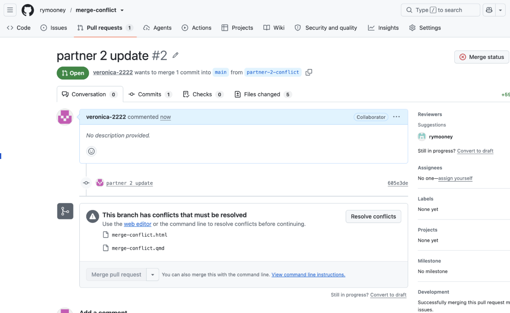

1.  a screenshot showing that GitHub reported a merge conflict,

    

2.  a screenshot showing the two competing versions in the conflict editor,

    

3.  a screenshot showing the final resolved version on main.

    
